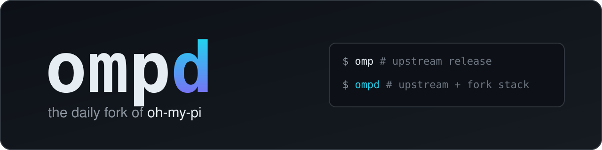
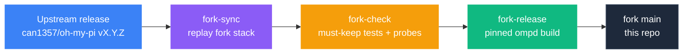

<p align="center">
  <picture>
    <source media="(prefers-color-scheme: dark)" srcset="assets/banner-dark.svg" />
    <source media="(prefers-color-scheme: light)" srcset="assets/banner-light.svg" />
    
  </picture>
</p>

<p align="center">
  
  
  
  
</p>

<p align="center">
  <strong>ompd is <a href="https://github.com/can1357/oh-my-pi">oh-my-pi (omp)</a> with a set of fork features added on top, rebased onto every upstream release.</strong>
</p>

> **This is not the official omp.** For the supported agent, install instructions and docs, go to
> [can1357/oh-my-pi](https://github.com/can1357/oh-my-pi) / [omp.sh](https://omp.sh). This repository is a
> personal fork: each upstream release is replayed with the fork's commits on top, and the result is run as a separate `ompd` channel.

<p align="center">
  <a href="#omp-vs-ompd">omp vs ompd</a> &bull;
  <a href="#what-the-fork-adds">What the fork adds</a> &bull;
  <a href="#build-from-source">Build from source</a> &bull;
  <a href="#how-the-fork-is-maintained">Maintenance</a> &bull;
  <a href="#faq">FAQ</a>
</p>

---

## omp vs ompd

Same agent and same CLI. ompd is a superset: every fork feature that sends data to a model is **off by default** or only runs when you call it.

| Area | omp v18.11.1 (upstream) | ompd (this fork) | Turn it on |
|:-----|:------------------------|:-----------------|:-----------|
| **Identity** | `omp` wordmark, `omp update` self-updater | `ompd` wordmark; update notice compares against the newest npm release | `OMP_CHANNEL=ompd` |
| **Model presets** | Roles + thinking level, written to config | Also saves fallback chains and cycle order; **Presets** sidebar in `/models`; loading only affects the session and never writes config | `/models` → Presets, `/modelpreset` |
| **Bash output** | Native minimizer + byte cap | Optional pruning of noise and repeated lines; the original output is kept as an `artifact://` | `bash.outputPruning.mode` |
| **Context** | Compaction, mechanical `/shake` | `/shake semantic` (a model removes results the task no longer needs; recoverable); compaction scales to small context windows | `/shake semantic`, `compaction.thresholdMinContextWindow` |
| **`find` tool** | Semantic search over the workspace | **Bounded mode**: ranks passages from named files only and reports an `answerPresent` probability | `find` with `paths` |
| **Skills** | Model reads the whole skill list | `recommend_skills` tool ranks skills for a task | `skills.recommend.enabled` (on) |
| **Async jobs** | Per-call timeout | Wall-clock cap for every eval/bash job + notices when a job stops making progress | `tools.wallCapMs` (1 h), `async.noProgressWarnMs` (60 s) |
| **Subagents** | In-process only | Can run as visible HerdR panes; subagents return structured results | `task.paneBackend` |
| **Browser** | `browser` tool, relay | `tab.task({ goal })` loop (observe → act → verify), per-site permission grants, owned-tab supervisor, cleanup of abandoned tabs | `browser.task.*`, `browser.permissions.grants` |
| **Browser relay** | Extension relay | Bound to one Chrome profile; omp-created tabs are marked and grouped per window | `browser.relay` |
| **Desktop control** | `computer` tool (native accessibility) | `computer.task({ goal })` loop, optional [Cua Driver](https://github.com/trycua/cua) backend, confirmation gate for send/delete/pay actions | `computer.task.backend` |
| **Credentials** | Per profile | Shared secrets file and MCP OAuth tokens shared across profiles | `OMP_SHARED_SECRETS_FILE` |

---

## What the fork adds



Each feature is one commit on top of the upstream tag (`git log v18.11.1..main`). The model calls go through the session's `judge` role.

<details>
<summary><strong>Model presets</strong> — swap a whole routing setup in one action</summary>

A preset saves role assignments, per-role fallback chains, the quick-switch cycle order and `defaultThinkingLevel`. Load, save and delete presets from the **Presets** sidebar in `/models`, or with `/modelpreset list|save|switch|delete`. Loading applies the preset to the current session as the highest-priority layer and never writes it to disk. Before anything changes, every role must resolve to an available model; if any doesn't, the preset isn't applied. Docs: [`docs/models.md`](../docs/models.md#model-presets).

</details>

<details>
<summary><strong>Bash output pruning</strong> — less noise in the model's context</summary>

`bash.outputPruning.mode`: `off` (default), `deterministic` (collapse repeated lines and drop build/install/progress noise by rule), or `semantic` (a model also judges the remaining routine output). Diagnostics, paths, counts, URLs and the first and last lines are always kept. If you ask for every line of output, nothing is pruned. Every pruned result points to the exact original via `artifact://`. Docs: [`docs/tools/bash.md`](../docs/tools/bash.md).

</details>

<details>
<summary><strong>Semantic shake and small-window compaction</strong></summary>

`/shake semantic` replaces old tool results with recoverable `artifact://` placeholders, but only when a model, given your task, says they're no longer needed. Errors and test/verification output are always kept. `compaction.thresholdMinContextWindow` makes compaction scale to small context windows. Nothing is sent to a model unless `reduction.egress` is `selected`. Docs: [`docs/compaction.md`](../docs/compaction.md#semantic-shake).

</details>

<details>
<summary><strong>Bounded <code>find</code></strong> — "is the answer in these files?"</summary>

`find` with `paths` reads only the named files, globs or internal URLs. It scores every passage once, re-reads each hit to confirm it hasn't changed, and reports a separate `answerPresent` probability with a verdict (`absent` / `partial` / `present`). Limits: `semanticFind.maxFiles` (24), `maxBytesPerFile` (256 KiB), `maxPassages` (2000). Docs: [`docs/tools/find.md`](../docs/tools/find.md#bounded-mode-paths).

</details>

<details>
<summary><strong><code>recommend_skills</code></strong></summary>

Ranks installed skills against a task (model-scored, with a keyword-matching fallback), returns the top matches with reasons, and returns no match when nothing fits. Docs: [`docs/tools/recommend_skills.md`](../docs/tools/recommend_skills.md).

</details>

<details>
<summary><strong>Async wall caps</strong></summary>

Every eval and bash async job has a wall-clock cap (`tools.wallCapMs`, default 1 hour). If a job stays silent for `async.noProgressWarnMs` (default 60 s), a notice is delivered, so a stuck child shows up instead of hanging the session.

</details>

<details>
<summary><strong>HerdR pane subagents</strong></summary>

`task.paneBackend`: `native` (default), `auto` (use a pane when omp itself runs inside HerdR), or `herdr`. A per-item `visible: true` also requests a pane. The pane child is the same omp CLI with the same model, effort and tool allowlist, and it writes a checked result file. Docs: [`docs/tools/task.md`](../docs/tools/task.md#pane-backend-herdr).

</details>

<details>
<summary><strong>Browser and desktop tasks</strong></summary>

`tab.task({ goal, values?, expect? })` and `computer.task({ goal, window | app })` pursue one goal step by step: observe the page or accessibility tree, pick one allowed action, act, then verify. Consequential actions (send, delete, pay, confirming dialogs) are blocked unless you pass `allowConsequential: true`. Browser changes need a user-granted scope (`browser.permissions.grants`). The desktop loop can use the [Cua Driver](https://github.com/trycua/cua) (`computer.task.backend: auto | native | cua`). Docs: [`docs/tools/computer.md`](../docs/tools/computer.md).

</details>

<details>
<summary><strong>Shared credentials</strong></summary>

`OMP_SHARED_SECRETS_FILE` points at a config overlay (mode 0600) holding secrets shared across profiles and channels. MCP OAuth credentials can also be shared across profiles, and expired tokens trigger reauthentication.

</details>

---

## Build from source

ompd has no binary releases. Run it from a checkout. Fresh clones need the workspace dependencies and the local Rust/N-API addon, so you need Bun ≥ 1.3.14 and a Rust toolchain:

```bash
git clone https://github.com/ZealousEar/oh-my-pi.git ompd
cd ompd
bun setup              # installs workspaces and builds @oh-my-pi/pi-natives

# Run as ompd, in its own profile so it doesn't share config with a stock omp install
OMP_CHANNEL=ompd OMP_PROFILE=ompd bun dev
```

Optional shell alias:

```bash
alias ompd='OMP_CHANNEL=ompd OMP_PROFILE=ompd bun /path/to/ompd/packages/coding-agent/src/cli.ts'
```

Re-run `bun run build:native` after pulling changes to Rust crates. More detail: the upstream [development guide](../README.md#getting-started-from-source).

---

## How the fork is maintained

- **Base:** the latest upstream tag. The fork's commits are replayed on top of it, never merged in.
- **Stack:** one commit per feature, plus a `fix(port)` follow-up commit when a rebase needs fixes. Branch `fork/stack-<version>`; `main` points to the current stack.
- **Gate:** before each release, the must-keep tests and CLI probes for every fork feature run against the new base. If upstream ships an equivalent feature, the fork's version is dropped.
- **Side by side:** `omp` (stock, pinned), `ompd` (this fork, pinned build) and `ompdev` (editable checkout) run as separate channels with separate profiles.

---

## FAQ

<details>
<summary><strong>Should I use this instead of omp?</strong></summary>

Probably not. Use upstream omp unless you want one of the features above. ompd is tuned for one person's workflow and lags each upstream release by the time it takes to rebase.

</details>

<details>
<summary><strong>Does ompd send more data to model providers?</strong></summary>

Not by default. Semantic pruning and semantic shake only send anything when `reduction.egress` is `selected`. Bounded `find`, `recommend_skills` and the task loops call the `judge` model only when you use them.

</details>

<details>
<summary><strong>Will these features land upstream?</strong></summary>

Some might. When upstream implements one, the fork drops its copy at the next rebase.

</details>

<details>
<summary><strong>Where are the upstream README and docs?</strong></summary>

They're unchanged in this repo: [`README.md`](../README.md), [`docs/`](../docs). GitHub shows this page because `.github/README.md` takes priority over the root README.

</details>

---

## License

MIT, same as upstream. See [`LICENSE`](../LICENSE).
